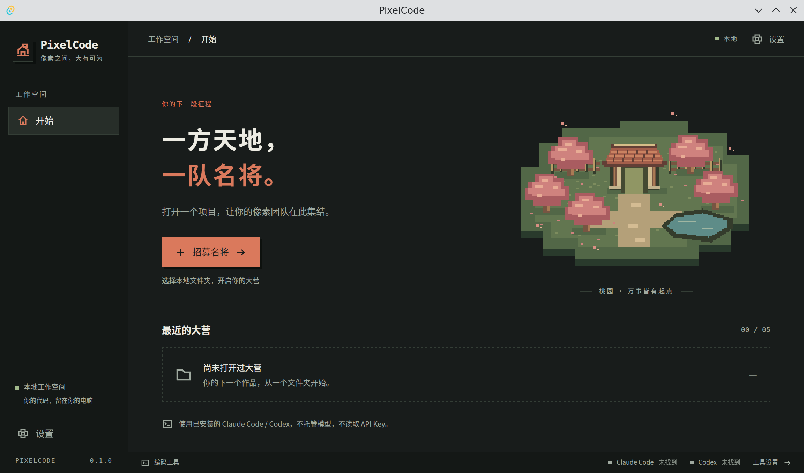

# PixelCode

本地桌面应用：用原创像素角色组成的"AI 团队"帮你完成编码任务。你是刘备，招募三国名将；主界面是一座像素风军营。



> **PixelCode 不提供模型额度，不自带模型，不读取、不保存、不传输你的 API Key。**
> 它只在本机调用你已安装并登录的 [Claude Code](https://code.claude.com) 或
> [Codex CLI](https://developers.openai.com/codex/cli)，费用和用量按你自己的 CLI 账号计算。
> 应用不需要注册、不上传代码或对话，数据都保存在本机。

## 安装

### 1. 先装好至少一个编码 CLI 并登录

| CLI | 安装 | 登录 | PixelCode 用来检查的命令 |
| --- | --- | --- | --- |
| Claude Code | 见 [官方文档](https://code.claude.com) | `claude` 后按提示登录 | `claude auth status --json` |
| Codex CLI | `npm i -g @openai/codex` | `codex login` | `codex login status` |

两个都没有时也能打开大营，设置页会显示"未找到"及登录引导，但不能派名将干活。
PixelCode 只在应用启动时继承的 `PATH` 里查找 CLI；从桌面图标启动时 `PATH` 可能与终端不同，
找不到时请确认 CLI 安装目录在系统 `PATH` 中，再在设置里点"重新探测 CLI"。

### 2. 下载安装包

安装包由 GitHub Actions 的 [Release 工作流](https://github.com/TarelX/PixelCode/actions/workflows/release.yml)
构建：推送 `v*` 标签时会附到 [Releases](https://github.com/TarelX/PixelCode/releases) 草稿里，
也可以打开任意一次成功的运行，在 **Artifacts** 下载 `PixelCode-Linux` / `PixelCode-Windows` / `PixelCode-macOS`。

| 系统 | 文件 | 安装方式 |
| --- | --- | --- |
| Windows 10/11 | `PixelCode_<版本>_x64-setup.exe` 或 `.msi` | 双击安装。安装包未签名，SmartScreen 提示时选"更多信息 → 仍要运行"。 |
| macOS | `PixelCode_<版本>_<arch>.dmg` | 拖入"应用程序"。未签名/未公证，首次打开请右键 → 打开。 |
| Debian / Ubuntu | `PixelCode_<版本>_amd64.deb` | `sudo apt install ./PixelCode_<版本>_amd64.deb`，命令为 `pixelcode` |
| Fedora 等 | `PixelCode-<版本>-1.x86_64.rpm` | `sudo dnf install ./PixelCode-<版本>-1.x86_64.rpm` |
| 其他 Linux | `PixelCode_<版本>_amd64.AppImage` | `chmod +x` 后直接运行 |

Linux 包依赖 WebKitGTK 4.1（Ubuntu 22.04+ / Debian 12+ 自带）。

### 3. 或从源码构建

需要 Node.js 22+、pnpm、Rust stable，Linux 还需要
`libwebkit2gtk-4.1-dev libappindicator3-dev librsvg2-dev patchelf build-essential libssl-dev`。

```bash
pnpm install
pnpm tauri build   # 安装包输出到 src-tauri/target/release/bundle/
```

## 使用

1. **招募名将**：在标题屏选择本地文件夹或 git 仓库，进入军营。最近 5 个大营会显示在标题屏。
2. **名将卡**：点名将查看/修改人设、技能、武器槽（CLI + 模型）和工具权限，也可新建自定义名将；
   改动保存在本机，修改过的预设可恢复默认。
3. **单将出征**：选一名将、写任务，看它在头顶气泡里流式输出，可随时停止；产物写入应用数据目录。
4. **队长出锦囊**：把需求交给诸葛亮，他会参考 `flows/` 里的修 bug、新项目、重构、调研流程拟出
   锦囊计划；需求不清时会先提问。
5. **点将**：在锦囊墙确认计划后，调度器按依赖顺序执行，运行检查命令（失败返工 ≤3 次），
   张昭审查（打回 ≤3 轮）。git 大营里独立锦囊在各自 worktree 中最多 3 个并行。
6. **交付**：全部通过后由你确认交付或放弃。PixelCode 不替你 `git commit`、合并或推送，
   改动留在大营工作区，由你检查后自行提交。
7. **军议**：选 2–4 名将就一个议题只读讨论两轮，队长再据此出锦囊草案，同样要经过点将。
8. **战报**：导出当天名将状态与锦囊进度的 PNG。
9. **语言**：设置里切换简体中文 / English。

应用数据（`pixelcode.db`、产物、worktree）位于系统应用数据目录下的 `com.pixelcode.desktop`：
Windows `%APPDATA%`、macOS `~/Library/Application Support`、Linux `~/.local/share`。

## 已知限制

- 只在你信任的项目里使用：Claude Code 的工具允许/禁止规则不是文件系统沙箱，允许编辑的名将会直接修改大营
  （git 大营的锦囊先在 worktree 中修改，再应用到工作区）；Codex 使用自身的 `--sandbox`。
- 开发验证用的是 fixture / 替身 CLI，尚未在真实登录的 Claude Code / Codex 上端到端跑通 v1 验收流程。
- CLI 参数按 Claude Code 2.1.330、Codex CLI 0.171.0 的 `--help` 核实；更旧版本可能缺少所需参数，
  会显示"无法确认状态"或启动失败。
- 非 git 大营不能并行，锦囊依次执行；单将出征一次只能运行一名将。
- 安装包未签名、未公证，没有自动更新。Windows / macOS 安装包只由 CI 构建，CI 在 Ubuntu 与 Windows 上
  运行检查与测试。
- 只支持 Claude Code 与 Codex 两种 CLI。

## 素材与许可

- 代码、名将精灵（`assets/sprites/`）、桃园与军营场景（`themes/three-kingdoms/tiles/`）均为本仓库原创，MIT 授权。
  精灵由 `python3 tools/sprites/generate.py` 生成，场景由 `python3 tools/generate_scenery.py`（需要 Pillow）生成，
  改图请改脚本后重新生成。
- 不包含第三方像素素材或字体；名将为原创形象，与任何游戏或品牌无官方关联。
- 界面布局参考 [MonoCode](https://www.usemono.dev/) 的清晰分区与 [Godly](https://godly.website/) 的留白和信息层级，
  未复制任何第三方代码或素材。

## 开发

```bash
pnpm install
pnpm tauri dev     # 启动桌面应用
pnpm typecheck
pnpm build
pnpm test          # 前端与配置测试（node --test）
cargo clippy --manifest-path src-tauri/Cargo.toml -- -D warnings
cargo test --manifest-path src-tauri/Cargo.toml
```

开发守则见 [AGENTS.md](AGENTS.md)，规格见 [docs/PIXELCODE_SPEC.md](docs/PIXELCODE_SPEC.md)。

## 技术说明

### CLI 探测（阶段 A · 任务 2）

按规格 §8.3 / §9.3，启动及进入设置时通过 Rust 的 `detect_clis` Tauri command
扫描当前进程的 PATH；前端 `useCliDetection` 只调用 command，不启动进程。
返回每个 CLI 的 `id / status / version / error`，状态为
`not_found / found / found_needs_login`。未安装 CLI 不影响打开大营。

本机通过 `--help` 核实的命令（Claude Code 2.1.330、Codex CLI 0.171.0）：
- `claude --version`、`claude auth status --json`（默认 JSON 的 `loggedIn` 布尔字段）。
- `codex --version`、`codex login status`（登录状态文本可能在 stderr）。

规格以 `codex --version` 为无害探测示例，但版本不证明登录，因此用真实存在的
`login status` 检查登录。不会运行推理、发起登录、读取凭证文件或回传原始认证输出。
每条命令最多等待 5 秒。旧版本不支持状态命令、输出未知、权限错误或超时时，
保守返回 `found_needs_login` 并附可读错误；界面显示“无法确认状态”，不误报已登录。
PATH 指应用启动时继承的环境（GUI 启动时可能与终端不同）。

适配器 fixture 覆盖已登录、未登录、空输出与错误输出。
fixture 中已登录输出为合成样本，未登录格式已在本机验证。
新建任务目前仍为空占位；规格要求的无可用 CLI 时拦截任务应在实现新建任务时接入，
不得仅凭 `version` 或有 `error` 的结果放行。

### Claude Code 单角色运行（阶段 B · 任务 3）

Rust 命令 `start_role_run(campId, roleId, loadoutIndex, prompt)` 使用已保存的大营目录、
该大营生效的角色配置和选中的 Claude Code 武器槽。一次只运行一个角色；调用在运行结束时返回，
应在调用前监听当前窗口的 `role-run` 事件。事件包含 `run_id / camp_id / role_id / type`；
`type` 为 `started`、`text`（含增量 `text`）、`tool`（含 `name`）、
`completed` 或 `failed`（含 `message`）。启动前校验错误直接由命令返回。

按 Claude Code 2.1.330 的 `--help`，使用 `claude -p --output-format stream-json --verbose
--include-partial-messages`，任务内容走 stdin，人设和技能走 `--append-system-prompt`。
`--tools` 限定内置工具，角色允许/禁止规则走 `--allowedTools` / `--disallowedTools`。
本阶段没有审批界面，使用 `--permission-mode dontAsk --permission-prompts none`，
不启用交互式审批或 `--permission-prompt-tool`。命令继承用户的 CLI 登录状态；
不加载大营的项目设置或 MCP 配置。仅在信任的大营运行：工具规则不等同于文件系统沙箱，
允许编辑的角色会直接修改大营目录，工作树、任务 UI 和停止操作尚未接入。

### Codex 单角色运行（阶段 B · 任务 4）

`start_role_run` 也支持选中的 Codex 武器槽，沿用上述 `role-run` 事件与单角色运行限制。
以本机 Codex CLI 0.171.0 的 `codex exec --help` / `codex --help` 核实参数：
`codex --ask-for-approval never exec --json --sandbox read-only -`；任务经 stdin 发送，
模型非 `auto` 时传 `--model`，人设和技能通过 `--config developer_instructions=...` 发送。
JSONL 结构按官方 `codex-rs/exec/src/exec_events.rs`，配置键按官方
`codex-rs/core/config.schema.json`；`docs/exec.md` 现链接至
<https://developers.openai.com/codex/noninteractive>。

仅同时允许 Write、Edit 且未禁止任一工具时使用 `workspace-write`，否则 `read-only`。
两种模式均保留 Codex 的 shell 工具，以便通过命令读取、搜索文件及运行检查。
写沙箱关闭网络（阻止联网 git push），排除临时目录，写入限制在大营工作目录；
只读角色即使通过 shell 读取、搜索文件也无法写入。Codex 不支持逐条翻译 Claude 的
Bash deny 规则，改由沙箱约束网络与写入范围；这不等于禁止工作目录内的删除操作。
`codex exec --help` 和配置 schema 没有独立的 `.git` 只读开关；官方
`codex-rs/protocol/src/permissions.rs` 的默认工作区策略已保护 `.git` 为只读，
因此不添加未确认的参数，也不放宽该默认保护。
使用 `--ignore-user-config --ignore-rules --ephemeral --skip-git-repo-check`，避免用户/项目
配置中的 MCP、hook 或规则扩大权限，不保存会话，支持非 git 大营。CLI 登录凭证仍由 CLI 使用，
但自定义供应商配置不会加载；本适配器要求支持这些参数的版本，不做不安全降级。
仅在信任的大营运行；本阶段尚无交互审批、停止操作、真实登录运行或跨平台沙箱验证。

### 队长动态编排（阶段 D · 任务 1）

队长拟定草案时会收到 `flows/*.yaml` 的四个内置参考流程（修 bug、新项目、重构、调研，规格 §7.3），
可套用、裁剪、组合或不用；非编码请求（如整理会议记录）可只招募所需名将并产出 Markdown 报告。
草案的输入产物须是其前置锦囊的首个输出产物；调度器在每个锦囊后检查产出非空，
空产出按检查失败返工（最多 3 次）。锦囊墙显示任务类型与本次招募的名将。

## English

PixelCode is a local desktop app that turns the coding agent CLIs you already have installed and signed in
(Claude Code, Codex) into a pixel-art team of Three Kingdoms generals working in a pixel-art camp.

- **It does not sell tokens, ship models, or read, store or send your API keys.** All usage is billed to your own CLI account; nothing is uploaded.
- **Install:** sign in to Claude Code (`claude`) or Codex (`npm i -g @openai/codex`, `codex login`), then download the Windows (`-setup.exe` / `.msi`), macOS (`.dmg`) or Linux (`.deb` / `.rpm` / `.AppImage`) bundle from the [Release workflow](https://github.com/TarelX/PixelCode/actions/workflows/release.yml) artifacts or [Releases](https://github.com/TarelX/PixelCode/releases), or build with `pnpm install && pnpm tauri build`. Bundles are unsigned.
- **Use:** open a folder or git repo, let the captain draft a task plan, approve it, and the scheduler runs each task, its check command and a read-only review before you accept delivery. PixelCode never commits or pushes for you. Switch the UI to English in Settings.
- **Known limits:** only use trusted projects (Claude tool rules are not a filesystem sandbox); not yet verified end to end against live CLI logins; parallel tasks need a git camp (max 3); only Claude Code and Codex are supported.

## License

MIT; all pixel art is original to this repository.
The workspace's anchored picker placement adapts MIT-licensed MonoCode code
(Copyright (c) 2026 Nick); see [third-party notices](THIRD_PARTY_NOTICES.md).
